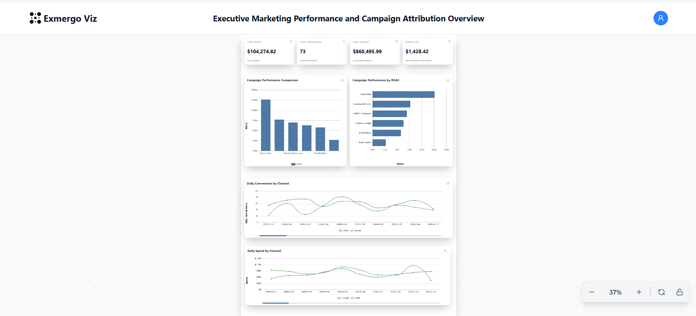

# MarTech Use Case

A reproducible MarTech analytics pipeline built with deterministic synthetic data,
Dagster, DuckDB, Dex, and dbt.

The project combines Google Ads, Meta Ads, and HubSpot CRM data into campaign
performance and attribution models. It also demonstrates one controlled data
quality scenario: `hubspot_second_association`.

## Current scope

Implemented:

- deterministic synthetic Google Ads, Meta Ads, and HubSpot CRM data;
- Dagster ingestion into local DuckDB raw tables;
- Dex/dbt staging, intermediate, and mart models;
- canonical spend, conversion, revenue, CAC, and ROAS metrics;
- an explicit one-attribution-row-per-deal contract;
- the `hubspot_second_association` scenario and clean-state recovery;
- an Exmergo Viz dashboard built from the clean analytical marts.

Only `hubspot_second_association` is implemented. Live APIs and additional drift
scenarios are not implemented. The analytical marts are visualized through an
Exmergo Viz dashboard.

## Architecture

```text
Synthetic source CSVs
        |
        v
Dagster ingestion
        |
        v
DuckDB raw tables
        |
        v
Dex / dbt transformations and tests
        |
        +--> mart_paid_ads_performance
        |
        +--> int_deal_attribution
                 |
                 v
            mart_campaign_attribution
        |
        v
CSV exports
        |
        v
Exmergo Viz dashboard
```

DuckDB permits one writer at a time, so ingestion groups and transformation
builds are run sequentially.

## Data sources

| Source | Generated dataset | Clean rows |
| --- | --- | ---: |
| Google Ads | Daily campaign performance | 186 |
| Meta Ads | Daily campaign performance | 186 |
| HubSpot | Contacts | 357 |
| HubSpot | Deals | 73 |
| HubSpot | Deal-contact associations | 73 |

The clean synthetic dataset covers 2026-07-01 through 2026-08-31. Generation
uses a fixed seed and fixed date range.

## Project structure

```text
.
|-- .dex/config.yml
|-- charts/
|   `-- martech_dashboard.png
|-- data/
|   `-- raw/                         # generated CSVs; not committed
|-- exports/
|   |-- mart_campaign_attribution.csv
|   |-- mart_paid_ads_performance.csv
|   `-- viz_prompts.md
|-- martech/
|   |-- assets/                      # Dagster ingestion assets
|   |-- models/
|   |   |-- staging/
|   |   |-- intermediate/
|   |   `-- marts/
|   |-- database.py
|   |-- definitions.py
|   |-- generate_fake_data.py
|   |-- dbt_project.yml
|   `-- profiles.yml
|-- pyproject.toml
`-- README.md
```

## Setup

The project requires Python 3.11 or newer and is tested with Python 3.13. Run all
commands from the repository root.

```powershell
Set-Location "C:\path\to\martech-use-case"

python -m venv .venv
& ".\.venv\Scripts\Activate.ps1"

python -m pip install --upgrade pip
python -m pip install -e .
python -m pip check
```

The editable install includes the DuckDB connector dependencies required by the
tested Dex/dbt workflow.

## Run the clean pipeline

Generate the clean deterministic inputs:

```powershell
python -m martech.generate_fake_data --scenario synthetic
```

Materialize the independent Dagster asset groups sequentially:

```powershell
dagster asset materialize `
    -m martech.definitions `
    --select "google_ads_raw"

dagster asset materialize `
    -m martech.definitions `
    --select "meta_ads_raw"

dagster asset materialize `
    -m martech.definitions `
    --select "hubspot_contacts_raw,hubspot_deals_raw,hubspot_deal_contacts_raw"
```

Build and test the transformation project:

```powershell
dex transform build --target dev
```

The clean build should complete with eight models and 32 passing tests.

## Analytical models

| Layer | Model | Purpose |
| --- | --- | --- |
| Staging | `stg_raw_google_ads` | Selects Google Ads source columns |
| Staging | `stg_raw_meta_ads` | Selects Meta Ads source columns |
| Staging | `stg_raw_hubspot_contacts` | Selects HubSpot contact columns |
| Staging | `stg_raw_hubspot_deals` | Selects HubSpot deal columns |
| Staging | `stg_raw_hubspot_deal_contacts` | Preserves deal-contact relationship rows |
| Intermediate | `int_deal_attribution` | Joins associations to contacts and deals |
| Mart | `mart_paid_ads_performance` | Harmonizes paid-media performance |
| Mart | `mart_campaign_attribution` | Combines paid spend with closed-won deals |

The raw relationship table may legitimately contain multiple contacts for one
deal. The analytical contract is declared in `int_deal_attribution`, where
`deal_id` is tested as both `not_null` and `unique`.

The intermediate model deliberately preserves one row per association. It does
not use `distinct` or otherwise deduplicate deals.

## Canonical metrics

| Metric | Definition |
| --- | --- |
| Spend | Paid-media spend across Google and Meta |
| Conversions | Distinct closed-won `deal_id` values attributed per campaign |
| Revenue | Sum of attributed closed-won deal amount |
| CAC | `spend / conversions` |
| ROAS | `revenue / spend` |

## Visualization

The clean analytical marts are exported to CSV and used as inputs to Exmergo Viz.

The dashboard provides an executive view of marketing performance and campaign
attribution, including:

- Total Spend
- Total Conversions
- Total Revenue
- Overall CAC
- Campaign ROAS comparison
- Daily Conversions by Channel
- Daily Spend by Channel

### Dashboard

[Open the interactive MarTech dashboard](https://viz.exmergo.com/share/7934f1a1-0071-4e5c-83a8-f80d60c5f6b8)



### Viz inputs

The reproducible Viz inputs are stored in `exports/`:

- `mart_campaign_attribution.csv`
- `mart_paid_ads_performance.csv`
- `viz_prompts.md`

## Scenario: `hubspot_second_association`

The implemented scenario keeps the existing deal row and adds a second,
different contact association:

```text
DEAL-0001
|-- CONTACT-0006  (original)
`-- CONTACT-0055  (additional association)
```

Generate and ingest the scenario:

```powershell
python -m martech.generate_fake_data `
    --scenario hubspot_second_association

dagster asset materialize `
    -m martech.definitions `
    --select "hubspot_contacts_raw,hubspot_deals_raw,hubspot_deal_contacts_raw"
```

Verify that one deal now has multiple contacts:

```powershell
python -c "import duckdb; con = duckdb.connect('data/martech.duckdb', read_only=True); print(con.execute('SELECT deal_id, COUNT(DISTINCT contact_id) AS contacts FROM raw_hubspot_deal_contacts GROUP BY deal_id HAVING COUNT(DISTINCT contact_id) > 1').fetchall()); con.close()"
```

Expected result:

```text
[('DEAL-0001', 2)]
```

### Detection behavior

Without the analytical grain contract, the extra association would fan out the
attribution join and **would inflate attribution metrics if allowed
downstream**.

Run the guarded build:

```powershell
dex transform build --target dev
```

The implemented uniqueness contract instead causes
`unique_int_deal_attribution_deal_id` to fail. dbt then blocks/skips
`mart_campaign_attribution`, preventing the affected mart from being
published. A nonzero exit code is expected for this scenario build.

## Restore the clean state

```powershell
python -m martech.generate_fake_data --scenario synthetic

dagster asset materialize `
    -m martech.definitions `
    --select "hubspot_contacts_raw,hubspot_deals_raw,hubspot_deal_contacts_raw"

dex transform build --target dev
```

The uniqueness test and `mart_campaign_attribution` should succeed again.

## Not implemented / future scope

The following are intentionally outside the current implementation:

- live Google Ads, Meta Ads, or HubSpot API clients;
- replay clients or recorded live fixtures;
- the proposed Google cost-field rename scenario;
- the proposed Meta token-expiration scenario;
- production deployment and scheduling;
- automated correlation of findings across separate ingestion and
  transformation projects.